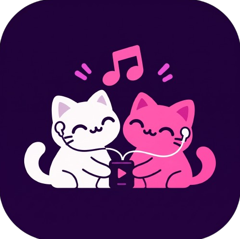

<a id="readme-top"></a>

[![Forks][forks-shield]][forks-url]
[![Stargazers][stars-shield]][stars-url]
[![Issues][issues-shield]][issues-url]
[![GPL-3.0 License][license-shield]][license-url]


<!-- PROJECT LOGO -->
<br />
<div align="center">
  
  <h3 align="center">Songshare</h3>

  <p align="center">
    Share a song link, trim the part you like and send it on WhatsApp.
    <br />
    <a href="README.tr.md"><strong>Türkçe</strong></a>
    <br />
    <br />
    <a href="https://github.com/aybrkaknc/Songshare/issues/new?labels=bug">Report Bug</a>
    &middot;
    <a href="https://github.com/aybrkaknc/Songshare/issues/new?labels=enhancement">Request Feature</a>
  </p>
</div>


<!-- TABLE OF CONTENTS -->
<details>
  <summary>Table of Contents</summary>
  <ol>
    <li>
      <a href="#about-the-project">About The Project</a>
      <ul>
        <li><a href="#built-with">Built With</a></li>
      </ul>
    </li>
    <li>
      <a href="#getting-started">Getting Started</a>
      <ul>
        <li><a href="#prerequisites">Prerequisites</a></li>
        <li><a href="#installation">Installation</a></li>
      </ul>
    </li>
    <li><a href="#usage">Usage</a></li>
    <li><a href="#legal-notice">Legal Notice</a></li>
    <li><a href="#contributing">Contributing</a></li>
    <li><a href="#license">License</a></li>
    <li><a href="#contact">Contact</a></li>
    <li><a href="#acknowledgments">Acknowledgments</a></li>
  </ol>
</details>


<!-- ABOUT THE PROJECT -->
## About The Project

Songshare receives a song link from the Android share menu, downloads the audio with yt-dlp, opens a trim screen and sends the selected part as an MP3 through the share menu (WhatsApp or any other app).

* YouTube links are downloaded directly.
* Spotify, Deezer, Apple Music, SoundCloud and Bandcamp links: the artist and song name are read from the link, YouTube is searched and you pick the right result from 5 candidates.
* Three ways to get the Spotify song name: read from the page (default), Spotify Web API with your own key, or type it yourself.
* Trim with a range slider, exact `m:ss.t` time fields and a waveform. Preview the selected part before sending.
* 192 kbps MP3 with an editable file name (default `Artist - Song.mp3`).
* After sharing, the app asks whether to save the clip to `Download/Songshare`. "Always save" skips the question.
* Download progress in a notification, with a cancel button.
* yt-dlp is checked for updates on launch (can be turned off) and can be updated by hand in Settings.
* English and Turkish UI, selectable in the app.

<p align="right">(<a href="#readme-top">back to top</a>)</p>


### Built With

* [Kotlin](https://kotlinlang.org/)
* [Jetpack Compose](https://developer.android.com/compose)
* [youtubedl-android](https://github.com/yausername/youtubedl-android) (yt-dlp, Python and FFmpeg)

<p align="right">(<a href="#readme-top">back to top</a>)</p>


<!-- GETTING STARTED -->
## Getting Started

To get a local copy up and running, follow these steps.

### Prerequisites

* Android 8.0 (API 26) or newer on the device
* JDK 17 or newer and the Android SDK (platform 36) to build

### Installation

1. Clone the repo
   ```sh
   git clone https://github.com/aybrkaknc/Songshare.git
   ```
2. Enter the project folder
   ```sh
   cd Songshare
   ```
3. Build the debug APKs
   ```sh
   ./gradlew assembleDebug
   ```
4. Install the APK for your device's ABI (most phones are `arm64-v8a`)
   ```sh
   adb install -r app/build/outputs/apk/debug/app-arm64-v8a-debug.apk
   ```

One APK is built per ABI because yt-dlp, Python and FFmpeg add about 50 MB per ABI. `app-universal-debug.apk` works on every device but is much larger.

For the Spotify Web API method, create an app on [developer.spotify.com](https://developer.spotify.com/dashboard) and enter its Client ID and Secret in Settings. They are stored encrypted on the device only.

<p align="right">(<a href="#readme-top">back to top</a>)</p>


<!-- USAGE EXAMPLES -->
## Usage

1. In a music app, tap Share on a song and choose Songshare (or paste the link on the home screen).
2. For non-YouTube links, check the search text and pick the right video from the list.
3. Wait for the download, then set the start and end with the slider, the time fields or the waveform.
4. Tap Preview to listen, edit the file name if you like, then tap Share and choose WhatsApp and the contact.
5. When you come back, choose whether to save the clip on the device.

<p align="right">(<a href="#readme-top">back to top</a>)</p>


<!-- LEGAL NOTICE -->
## Legal Notice

Downloading content from YouTube and other services may be against their terms of service, and songs are usually protected by copyright. Use Songshare only for content you have the right to download and share. You are responsible for how you use it.

<p align="right">(<a href="#readme-top">back to top</a>)</p>


<!-- CONTRIBUTING -->
## Contributing

Contributions are what make the open source community such an amazing place to learn, inspire, and create. Any contributions you make are **greatly appreciated**.

If you have a suggestion that would make this better, please fork the repo and create a pull request. You can also simply open an issue with the tag "enhancement".

1. Fork the Project
2. Create your Feature Branch (`git checkout -b feature/AmazingFeature`)
3. Commit your Changes (`git commit -m 'Add some AmazingFeature'`)
4. Push to the Branch (`git push origin feature/AmazingFeature`)
5. Open a Pull Request

<p align="right">(<a href="#readme-top">back to top</a>)</p>


<!-- LICENSE -->
## License

Distributed under the GNU General Public License v3.0. See `LICENSE` for more information.

<p align="right">(<a href="#readme-top">back to top</a>)</p>


<!-- CONTACT -->
## Contact

Project Link: [https://github.com/aybrkaknc/Songshare](https://github.com/aybrkaknc/Songshare)

<p align="right">(<a href="#readme-top">back to top</a>)</p>


<!-- ACKNOWLEDGMENTS -->
## Acknowledgments

* [youtubedl-android](https://github.com/yausername/youtubedl-android), GPL-3.0
* [yt-dlp](https://github.com/yt-dlp/yt-dlp), Unlicense
* [FFmpeg](https://ffmpeg.org/legal.html), LGPL/GPL
* [Best-README-Template](https://github.com/othneildrew/Best-README-Template)
* [Img Shields](https://shields.io)

<p align="right">(<a href="#readme-top">back to top</a>)</p>


<!-- MARKDOWN LINKS & IMAGES -->
[forks-shield]: https://img.shields.io/github/forks/aybrkaknc/Songshare.svg?style=for-the-badge
[forks-url]: https://github.com/aybrkaknc/Songshare/network/members
[stars-shield]: https://img.shields.io/github/stars/aybrkaknc/Songshare.svg?style=for-the-badge
[stars-url]: https://github.com/aybrkaknc/Songshare/stargazers
[issues-shield]: https://img.shields.io/github/issues/aybrkaknc/Songshare.svg?style=for-the-badge
[issues-url]: https://github.com/aybrkaknc/Songshare/issues
[license-shield]: https://img.shields.io/github/license/aybrkaknc/Songshare.svg?style=for-the-badge
[license-url]: https://github.com/aybrkaknc/Songshare/blob/main/LICENSE
