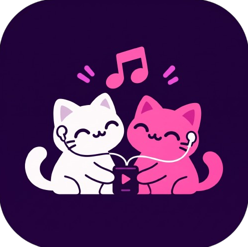

<a id="readme-top"></a>

[![Forks][forks-shield]][forks-url]
[![Stargazers][stars-shield]][stars-url]
[![Issues][issues-shield]][issues-url]
[![GPL-3.0 Lisans][license-shield]][license-url]


<!-- PROJE LOGOSU -->
<br />
<div align="center">
  
  <h3 align="center">Songshare</h3>

  <p align="center">
    Bir şarkı linkini paylaş, sevdiğin kısmı kırp ve WhatsApp'tan gönder.
    <br />
    <a href="README.md"><strong>English</strong></a>
    <br />
    <br />
    <a href="https://github.com/aybrkaknc/Songshare/issues/new?labels=bug">Hata Bildir</a>
    &middot;
    <a href="https://github.com/aybrkaknc/Songshare/issues/new?labels=enhancement">Özellik İste</a>
  </p>
</div>


<!-- İÇİNDEKİLER -->
<details>
  <summary>İçindekiler</summary>
  <ol>
    <li>
      <a href="#proje-hakkında">Proje Hakkında</a>
      <ul>
        <li><a href="#kullanılan-teknolojiler">Kullanılan Teknolojiler</a></li>
      </ul>
    </li>
    <li>
      <a href="#başlarken">Başlarken</a>
      <ul>
        <li><a href="#gereksinimler">Gereksinimler</a></li>
        <li><a href="#kurulum">Kurulum</a></li>
      </ul>
    </li>
    <li><a href="#kullanım">Kullanım</a></li>
    <li><a href="#yasal-uyarı">Yasal Uyarı</a></li>
    <li><a href="#katkıda-bulunma">Katkıda Bulunma</a></li>
    <li><a href="#lisans">Lisans</a></li>
    <li><a href="#iletişim">İletişim</a></li>
    <li><a href="#teşekkürler">Teşekkürler</a></li>
  </ol>
</details>


<!-- PROJE HAKKINDA -->
## Proje Hakkında

Songshare, Android paylaşım menüsünden gelen şarkı linkini alır, sesi yt-dlp ile indirir, kırpma ekranını açar ve seçilen kısmı MP3 olarak paylaşım menüsüyle (WhatsApp veya başka bir uygulama) gönderir.

* YouTube linkleri doğrudan indirilir.
* Spotify, Deezer, Apple Music, SoundCloud ve Bandcamp linkleri: sanatçı ve şarkı adı linkten okunur, YouTube'da aranır ve 5 aday arasından doğrusunu sen seçersin.
* Spotify şarkı adı için üç yöntem: sayfadan oku (varsayılan), kendi anahtarınla Spotify Web API veya kendin yaz.
* Aralık kaydırıcısı, kesin `d:ss.s` zaman kutuları ve dalga formu ile kırpma. Göndermeden önce seçilen kısmı dinleyebilirsin.
* 192 kbps MP3, değiştirilebilir dosya adı (varsayılan `Sanatçı - Şarkı.mp3`).
* Paylaşımdan sonra kesitin `Download/Songshare` klasörüne kaydedilip kaydedilmeyeceği sorulur. "Her zaman kaydet" bu soruyu atlar.
* İndirme ilerlemesi bildirimde, iptal düğmesiyle birlikte.
* yt-dlp güncellemeleri açılışta kontrol edilir (kapatılabilir) ve Ayarlar'dan elle güncellenebilir.
* Uygulama içinden seçilebilen İngilizce ve Türkçe arayüz.

<p align="right">(<a href="#readme-top">başa dön</a>)</p>


### Kullanılan Teknolojiler

* [Kotlin](https://kotlinlang.org/)
* [Jetpack Compose](https://developer.android.com/compose)
* [youtubedl-android](https://github.com/yausername/youtubedl-android) (yt-dlp, Python ve FFmpeg)

<p align="right">(<a href="#readme-top">başa dön</a>)</p>


<!-- BAŞLARKEN -->
## Başlarken

Yerel bir kopya çalıştırmak için bu adımları izle.

### Gereksinimler

* Cihazda Android 8.0 (API 26) veya üstü
* Derlemek için JDK 17 veya üstü ve Android SDK (platform 36)

### Kurulum

1. Depoyu klonla
   ```sh
   git clone https://github.com/aybrkaknc/Songshare.git
   ```
2. Proje klasörüne gir
   ```sh
   cd Songshare
   ```
3. Debug APK'ları derle
   ```sh
   ./gradlew assembleDebug
   ```
4. Cihazının ABI'sine uygun APK'yı kur (çoğu telefon `arm64-v8a`)
   ```sh
   adb install -r app/build/outputs/apk/debug/app-arm64-v8a-debug.apk
   ```

yt-dlp, Python ve FFmpeg her ABI için yaklaşık 50 MB eklediğinden her ABI için ayrı APK üretilir. `app-universal-debug.apk` her cihazda çalışır ama çok daha büyüktür.

Spotify Web API yöntemi için [developer.spotify.com](https://developer.spotify.com/dashboard) üzerinde bir uygulama oluştur ve Client ID ile Secret değerlerini Ayarlar'a gir. Bu değerler yalnızca cihazda şifreli saklanır.

<p align="right">(<a href="#readme-top">başa dön</a>)</p>


<!-- KULLANIM -->
## Kullanım

1. Bir müzik uygulamasında şarkıda Paylaş'a dokun ve Songshare'i seç (ya da linki ana ekrana yapıştır).
2. YouTube dışı linklerde arama metnini kontrol et ve listeden doğru videoyu seç.
3. İndirme bitince başlangıç ve bitişi kaydırıcı, zaman kutuları veya dalga formuna bakarak ayarla.
4. Dinlemek için Dinle'ye dokun, istersen dosya adını değiştir, sonra Paylaş'a dokunup WhatsApp'ı ve kişiyi seç.
5. Geri döndüğünde kesitin cihaza kaydedilip kaydedilmeyeceğini seç.

<p align="right">(<a href="#readme-top">başa dön</a>)</p>


<!-- YASAL UYARI -->
## Yasal Uyarı

YouTube ve diğer servislerden içerik indirmek bu servislerin kullanım koşullarına aykırı olabilir ve şarkılar genellikle telif hakkıyla korunur. Songshare'i yalnızca indirme ve paylaşma hakkına sahip olduğun içerikler için kullan. Kullanım sorumluluğu sana aittir.

<p align="right">(<a href="#readme-top">başa dön</a>)</p>


<!-- KATKIDA BULUNMA -->
## Katkıda Bulunma

Katkılar açık kaynak topluluğunu öğrenmek, ilham almak ve üretmek için harika bir yer yapar. Yaptığın her katkı **çok değerli**.

Projeyi daha iyi hale getirecek bir önerin varsa projeyi fork'layıp bir pull request aç. Ayrıca "enhancement" etiketiyle bir issue da açabilirsin.

1. Projeyi fork'la
2. Özellik dalını oluştur (`git checkout -b feature/AmazingFeature`)
3. Değişikliklerini commit'le (`git commit -m 'Add some AmazingFeature'`)
4. Dalı push'la (`git push origin feature/AmazingFeature`)
5. Pull request aç

<p align="right">(<a href="#readme-top">başa dön</a>)</p>


<!-- LİSANS -->
## Lisans

GNU General Public License v3.0 altında dağıtılır. Ayrıntılar için `LICENSE` dosyasına bak.

<p align="right">(<a href="#readme-top">başa dön</a>)</p>


<!-- İLETİŞİM -->
## İletişim

Proje Linki: [https://github.com/aybrkaknc/Songshare](https://github.com/aybrkaknc/Songshare)

<p align="right">(<a href="#readme-top">başa dön</a>)</p>


<!-- TEŞEKKÜRLER -->
## Teşekkürler

* [youtubedl-android](https://github.com/yausername/youtubedl-android), GPL-3.0
* [yt-dlp](https://github.com/yt-dlp/yt-dlp), Unlicense
* [FFmpeg](https://ffmpeg.org/legal.html), LGPL/GPL
* [Best-README-Template](https://github.com/othneildrew/Best-README-Template)
* [Img Shields](https://shields.io)

<p align="right">(<a href="#readme-top">başa dön</a>)</p>


<!-- BAĞLANTILAR -->
[forks-shield]: https://img.shields.io/github/forks/aybrkaknc/Songshare.svg?style=for-the-badge
[forks-url]: https://github.com/aybrkaknc/Songshare/network/members
[stars-shield]: https://img.shields.io/github/stars/aybrkaknc/Songshare.svg?style=for-the-badge
[stars-url]: https://github.com/aybrkaknc/Songshare/stargazers
[issues-shield]: https://img.shields.io/github/issues/aybrkaknc/Songshare.svg?style=for-the-badge
[issues-url]: https://github.com/aybrkaknc/Songshare/issues
[license-shield]: https://img.shields.io/github/license/aybrkaknc/Songshare.svg?style=for-the-badge
[license-url]: https://github.com/aybrkaknc/Songshare/blob/main/LICENSE
